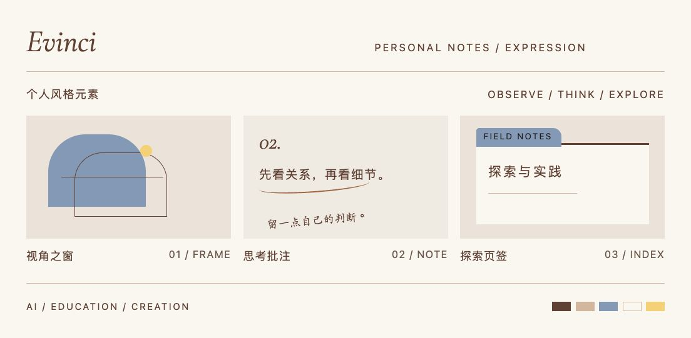
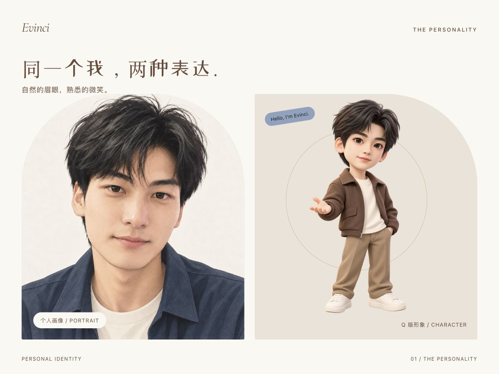

<h1 align="center">Evinci · 个人视觉体系</h1>

Understand complexity. Act simply. AI · 教育 · 创作

## 有结构的好奇心

好奇心带来新的视角，结构让表达清楚。现代编辑排版、自然的质感与少量奇想，共同构成清晰、自主、生动的个人表达。

## 个人形象

## 色彩与风格

咖啡棕与奶茶色建立识别，雾霾蓝组织层次，少量浅彩标记灵感。衬线标题、清楚的正文和一行手写批注，让思考有结构，也留下自己的判断。

## 我的视觉表达

<a href="assets/character.png">Q 版形象</a> · <a href="assets/avatar.png">个人画像</a> · <a href="design/palette.json">色彩</a>

