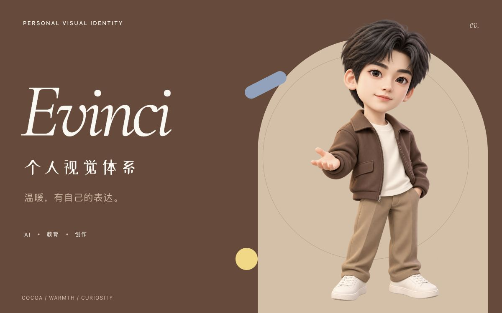
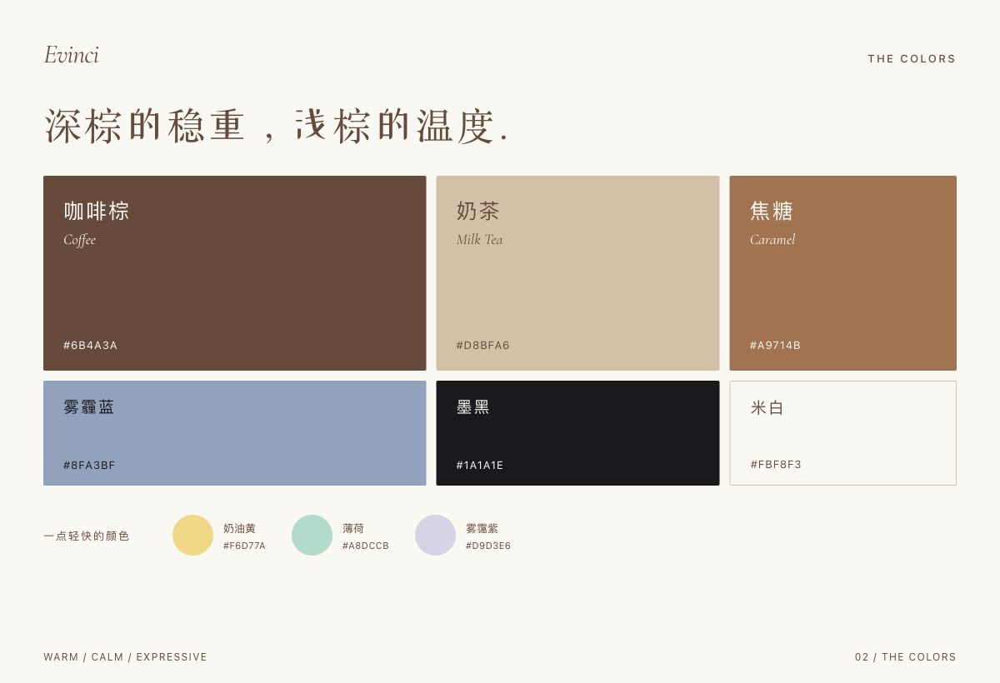
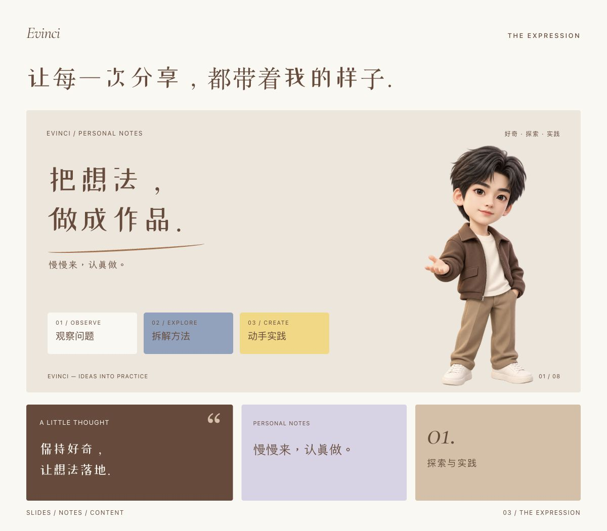

<h1 align="center">Evinci · 个人视觉体系</h1>

温暖，有自己的表达。 AI · 教育 · 创作

## 个人形象

## 色彩与风格

以咖啡棕与奶茶色建立温暖、稳重的底色，用雾霾蓝带来清爽的层次，再以少量浅彩保留轻快与好奇。克制的编辑排版、富有笔触的艺术字，与亲切的 3D Q 版形象，构成我的个人表达。

## 我的视觉表达

<a href="assets/character.png">Q 版形象</a> · <a href="assets/avatar.png">个人画像</a> · <a href="design/palette.json">色彩</a>

